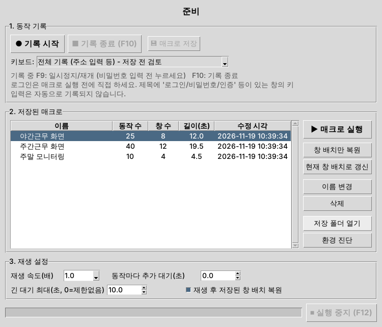

# 업무 화면 자동 배치 매크로 (프로토타입)

교대근무 출근 시 반복하는 **"웹페이지·팝업 수십 개 열기 → 크기/위치 배치"** 작업을
한 번 기록해 두고, 다음부터는 버튼 하나로 재현하는 Windows용 프로그램입니다.



---

## 1. 기술 검토 결과

| 기능 | 사용 기술 | 선택 이유 |
|---|---|---|
| 마우스·키보드 기록 | **pynput** (Windows 저수준 후킹 `SetWindowsHookEx`) | 관리자 권한 없이 동작, 순수 Python, PyInstaller 호환 |
| 마우스·키보드 재생 | pynput `Controller` (내부적으로 `SendInput`) | 다중 모니터 음수 좌표 지원 |
| 창 위치/크기 조회·변경 | **ctypes** 로 Win32 API 직접 호출 (`EnumWindows`, `GetWindowRect`, `SetWindowPos`, `Get/SetWindowPlacement`) | pywin32 설치 불필요, 일반 사용자 권한 |
| 모니터 구성 | `EnumDisplayMonitors` / `GetMonitorInfo` | 모니터별 좌표·해상도 저장 |
| 배율(DPI) 차이 | `SetProcessDpiAwarenessContext` (이 프로세스에만 적용) | 125%/150% 모니터가 섞여도 좌표가 어긋나지 않음 |
| GUI | tkinter (Python 기본 포함) | 추가 설치 불필요, 가벼움 |
| 저장 | 로컬 JSON 파일 | 사람이 읽을 수 있고 외부 서버 불필요 |

외부 라이브러리는 **pynput 하나**뿐입니다. 인터넷/서버 통신 코드는 없습니다.

### 검토했지만 제외한 방법
- **pyautogui**: 재생만 가능하고 기록 기능이 없음.
- **keyboard / mouse 패키지**: 일부 환경에서 관리자 권한 필요, 유지보수 중단.
- **Selenium / Chrome 원격 디버깅**: URL·탭을 정확히 열 수 있지만 Chrome을 특수 옵션으로 실행해야 하고
  회사 보안정책과 충돌할 수 있어 프로토타입에서는 제외.

## 2. 구현상 제약 및 어려운 점 (꼭 읽어 주세요)

1. **좌표 기반 재생입니다.** 화면 해상도, 모니터 배치, Windows 배율, 브라우저 확대/축소, 페이지 레이아웃이
   기록 당시와 다르면 클릭 위치가 어긋납니다. → 실행 전 모니터 구성이 다르면 **경고**를 띄웁니다.
2. **페이지 로딩 속도.** 기록 당시보다 페이지가 늦게 뜨면 클릭이 빗나갈 수 있습니다.
   → `동작마다 추가 대기` 값을 0.3~1초 정도로 올리거나 재생 속도를 낮추세요.
3. **Chrome 창 안의 내용(탭, URL)은 Windows API로 알 수 없습니다.** 창은 **제목**으로 구분합니다.
   제목이 바뀌는 페이지는 "열린 순서"로 대신 짝지어 배치합니다.
4. **한글 입력(IME)**: 키를 '물리 키' 단위로 재생하므로 재생 시 한/영 상태가 기록 당시와 같아야 합니다.
   주소창에는 가능하면 **영문 URL 또는 즐겨찾기 클릭**을 사용하세요.
   (한글 모드에서 입력한 글자는 검토 화면에 영문 자판 글자로 보입니다.)
5. **관리자 권한으로 실행된 프로그램 창**은 일반 권한 프로그램이 조작할 수 없습니다(Windows 보안 정책, UIPI).
   Chrome은 일반 권한이므로 문제 없습니다.
6. **잠금 화면, UAC 창, Ctrl+Alt+Del 화면**에서는 기록·재생이 동작하지 않습니다(정상적인 보안 동작).
7. Chrome은 DPI가 다른 모니터로 옮겨질 때 크기를 다시 계산하므로, 창 배치는 **2번 적용**해서 보정합니다.
8. 회사 보안 솔루션(키보드 보안 프로그램 등)이 저수준 키보드 후킹을 차단하면 키 입력 기록이 안 될 수 있습니다.
   이 경우 키보드 모드를 "키보드 기록 안 함"으로 두고 마우스(즐겨찾기 클릭) 위주로 기록하세요.

## 3. 설치 및 실행

### 3-1. Python 설치 (관리자 권한 불필요)
1. https://www.python.org/downloads/windows/ 에서 Python 3.10 이상 설치 파일을 받습니다.
2. 설치 화면에서 **"Add python.exe to PATH" 체크**, **"Install for all users"는 체크 해제**
   → 현재 사용자 폴더에 설치되므로 관리자 권한이 필요 없습니다.

> 회사 PC에 Python 설치가 금지되어 있다면, 다른 PC에서 [8장](#8-exe-파일-만들기-pyinstaller)의 방법으로
> EXE를 만들어 복사해 사용하세요(EXE는 설치 없이 실행됩니다). 사내 정책상 허용되는지 먼저 확인하세요.

### 3-2. 라이브러리 설치
`browser_macro` 폴더에서 명령 프롬프트(cmd)를 열고:

```bash
python -m pip install --user -r requirements.txt
```

필요한 라이브러리: `pynput` (requirements.txt). 테스트·EXE 빌드용: `pytest`, `pyinstaller` (requirements-dev.txt).

### 3-3. 실행
`run.bat` 더블클릭, 또는

```bash
python main.py
```

## 4. 프로젝트 파일 구조

```
browser_macro/
├─ main.py                 실행 진입점 (DPI 설정 후 GUI 실행)
├─ run.bat                 더블클릭 실행용
├─ build_exe.bat           EXE 만들기 (PyInstaller)
├─ run_tests.bat           자동 테스트 실행
├─ requirements.txt        필요 라이브러리 (pynput)
├─ requirements-dev.txt    테스트/빌드용 (pytest, pyinstaller)
├─ macro_app/
│  ├─ gui.py               화면(tkinter): 기록/저장/목록/실행/설정/검토 창
│  ├─ recorder.py          동작 기록 (클릭·드래그·스크롤·키, 창 이동 감지, F9/F10)
│  ├─ player.py            동작 재생 (시간 간격·속도·추가 대기·중지·키 눌림 해제)
│  ├─ layout.py            창 배치 저장/복원, 창 짝짓기, 모니터 구성 비교
│  ├─ privacy.py           민감정보 차단(키워드·의심 문자열 판정·삭제)
│  ├─ storage.py           매크로/설정 JSON 저장·불러오기·이름 변경·삭제
│  └─ winapi.py            Windows API (ctypes) - 창/모니터/DPI
├─ tests/
│  ├─ test_core.py         기록·재생·창배치·민감정보·저장 단위 테스트
│  ├─ test_gui.py          GUI 전체 흐름 테스트
│  ├─ integration_xvfb.py  실제 입력 기록→재생 통합 테스트 (Linux 개발용)
│  └─ fakes.py             테스트용 가짜 객체
└─ data/                   (실행 시 자동 생성) 매크로와 설정 저장 위치
   ├─ macros/*.json
   └─ settings.json
```

## 5. 사용 설명서 (처음 쓰는 분용)

### 준비
- Chrome을 열고 **사내 시스템에 직접 로그인**합니다. (로그인 과정은 기록하지 마세요.)
- 매크로를 기록할 때와 실행할 때 **모니터 구성·Windows 배율·Chrome 확대 비율을 같게** 유지하세요.

### ① 기록하기
1. 프로그램을 실행하고 **[● 기록 시작]** 을 누릅니다. 상단에 "● 기록 중"이 표시됩니다.
   (프로그램 창은 항상 위에 떠 있으며, 이 창에서의 클릭은 기록되지 않습니다.)
2. 평소처럼 작업합니다: 즐겨찾기 클릭, 주소 입력, 팝업 열기, 창을 끌어서 옮기기, 모서리로 크기 조절 등.
3. 비밀번호 등 민감한 입력을 해야 하면 **F9**(일시정지) → 입력 → **F9**(재개).
4. 모든 창 배치를 마쳤으면 **F10** 또는 **[■ 기록 종료]**.
5. 입력한 글자가 있으면 **검토 창**이 뜹니다. 비밀번호·인증번호로 보이는 항목은 자동으로 "삭제"가 체크되어 있습니다.
   저장하면 안 되는 내용은 모두 "삭제"를 체크한 뒤 [확인].
6. 매크로 이름(예: `주간근무 화면`)을 입력하면 저장됩니다.
   - 이때 **기록 종료 시점의 Chrome 창 위치·크기**도 함께 저장됩니다.

### ② 실행하기
1. Chrome 로그인을 먼저 직접 합니다.
2. 목록에서 매크로를 고르고 **[▶ 매크로 실행]** (또는 더블클릭).
3. **3초 카운트다운** 후 프로그램 창이 최소화되고 재생이 시작됩니다. 마우스·키보드를 건드리지 마세요.
4. 재생이 끝나면 저장된 **창 배치가 자동 복원**되고 결과가 표시됩니다.
5. 멈추려면 언제든 **F12** (또는 카운트다운 중 [⏹ 실행 중지]).

### ③ 기타 버튼
| 버튼 | 설명 |
|---|---|
| 창 배치만 복원 | 이미 창들이 열려 있을 때 위치·크기만 다시 맞춤 |
| 현재 창 배치로 갱신 | 지금 배치한 창 위치를 이 매크로의 '최종 배치'로 덮어씀 |
| 이름 변경 / 삭제 | 매크로 관리 |
| 저장 폴더 열기 | `data\macros` 폴더 열기 (백업·다른 PC로 복사 가능) |
| 환경 진단 | 모니터 구성, DPI 모드, 감지된 Chrome 창 목록 표시 |

### ④ 재생 설정
| 설정 | 설명 | 권장 |
|---|---|---|
| 재생 속도(배) | 2.0 = 2배 빠르게, 0.5 = 절반 속도 | 처음엔 1.0 |
| 동작마다 추가 대기(초) | 클릭/키 입력 전마다 추가로 기다림 (느린 페이지 대비) | 0 ~ 1 |
| 긴 대기 최대(초) | 기록 중 오래 멈췄던 구간을 이 시간으로 줄임 (0 = 그대로) | 5 ~ 10 |
| 재생 후 창 배치 복원 | 재생이 끝난 뒤 저장된 창 위치·크기를 적용 | 켬 |

### 단축키 요약
| 키 | 언제 | 기능 |
|---|---|---|
| F9 | 기록 중 | 기록 일시정지 / 재개 (그 사이 입력은 메모리에도 남지 않음) |
| F10 | 기록 중 | 기록 종료 |
| F12 | 카운트다운·재생 중 | **긴급 중지** (눌려 있던 키·마우스 버튼도 자동 해제) |

F9/F10/F12 자체는 매크로에 기록되지 않습니다.

## 6. 민감정보 보호 방식

| 단계 | 방법 |
|---|---|
| 기록 중 (자동) | 맨 앞 창 제목에 `로그인, 비밀번호, 패스워드, 암호, 인증, 본인확인, OTP, login, sign in, password …` 가 포함되면 그 창의 **키 입력은 기록하지 않음** (마커만 남김) |
| 기록 중 (수동) | **F9 일시정지** — 일시정지 중의 입력과 시간은 아예 저장되지 않음 |
| 키보드 모드 | `단축키·특수키만` 또는 `키보드 기록 안 함` 선택 시 일반 글자는 처음부터 기록 안 함 |
| 저장 전 | **검토 창**: 입력한 모든 문자열 표시, 숫자 4~8자리(인증번호)·주민번호·카드번호·문자/숫자/기호 혼합(비밀번호 의심)은 자동 삭제 체크 및 화면에서도 `a****9` 처럼 가려서 표시 |
| 저장 | 검토 후 남은 내용만 파일에 저장, 삭제된 자리에는 `redacted`(글자 수만) 표시 |
| 운영 원칙 | 로그인은 항상 사람이 직접 → 그 다음 매크로 실행 |

키워드는 `data\settings.json` 의 `"sensitive_keywords"` 에 목록으로 넣어 바꿀 수 있습니다
(`null` 이면 기본 목록 사용).

## 7. 매크로 파일 형식 (참고)

```json
{
 "format": "browser-layout-macro", "version": 1, "name": "주간근무 화면",
 "monitors": [{"rect": [0, 0, 1920, 1080], "primary": true}, {"rect": [-1920, 0, 0, 1080]}],
 "layout": [{"title": "근무표 - Google Chrome", "rect": [-1920, 0, -960, 1040], "state": "normal"}],
 "events": [
  {"t": 1.25, "type": "mouse_down", "x": 512, "y": 40, "button": "left"},
  {"t": 1.31, "type": "mouse_up",   "x": 512, "y": 40, "button": "left"},
  {"t": 2.10, "type": "key_down", "name": "enter", "vk": 13},
  {"t": 5.00, "type": "window_rect", "title": "...", "rect": [0, 0, 960, 1040], "state": "normal"}
 ]
}
```
- `t`: 기록 시작 후 경과 시간(초). 마우스 이동은 **드래그 중에만** 0.03초·4픽셀 간격으로 저장하고,
  연속 스크롤은 하나로 합쳐 파일 크기를 줄였습니다.
- `window_rect`: 마우스로 창을 옮기거나 크기를 바꾼 직후의 창 위치. 재생 시 드래그 결과가 조금 달라도 정확한 위치로 보정합니다.

## 8. EXE 파일 만들기 (PyInstaller)

Python이 설치된 PC에서 `build_exe.bat` 더블클릭 → `dist\BrowserLayoutMacro.exe` 생성.
EXE를 원하는 폴더에 복사해 실행하면 같은 폴더에 `data\` 가 만들어집니다
(폴더에 쓰기 권한이 없으면 `%LOCALAPPDATA%\BrowserLayoutMacro` 에 저장).

> 단일 EXE는 일부 백신/보안 프로그램이 "키 입력 후킹 프로그램"으로 오탐할 수 있습니다.
> 사내 배포 전 보안 담당자에게 확인을 받으세요.

## 9. Windows에서 테스트하는 방법

### 9-1. 자동 테스트 (2분)
```bash
python -m pip install --user -r requirements-dev.txt
```
```bash
python -m pytest -v
```
또는 `run_tests.bat`. 31개 테스트가 모두 `passed` 여야 합니다.

### 9-2. 수동 기능 테스트 체크리스트
| # | 시험 | 기대 결과 |
|---|---|---|
| 1 | [환경 진단] 클릭 | 모니터 개수·해상도·위치, 열린 Chrome 창 목록이 정확히 표시 |
| 2 | Chrome 2~3개 창을 연 상태로 기록 시작 → 즐겨찾기 클릭, 새 창(Ctrl+N)에서 `www.example.com` 입력+Enter, 창을 다른 모니터로 끌어 옮기고 크기 조절 → F10 → 이름 `테스트1` | 검토 창에 `www.example.com` 표시(삭제 미체크), 저장 후 목록에 `테스트1` |
| 3 | Chrome 창을 모두 닫고 `테스트1` 실행 | 3초 카운트다운 → 동일한 페이지/창이 열리고 같은 위치·크기로 배치 |
| 4 | 창 위치를 아무렇게나 흐트러뜨린 후 [창 배치만 복원] | 저장된 위치로 이동, 최대화 창은 원래 모니터에서 최대화 |
| 5 | 실행 도중 F12 | 즉시 중지, 상태 "사용자가 중지했습니다", 키가 눌린 채 남지 않음(Shift/Ctrl 정상) |
| 6 | 기록 중 메모장에 `Abcd1234!` 와 `123456` 입력 | 검토 창에서 두 항목이 자동 "삭제" 체크, 내용은 가려서 표시. 저장된 JSON에 해당 문자 없음 |
| 7 | 창 제목에 "로그인"이 있는 페이지에서 글자 입력 | 해당 입력은 검토 창에도 나오지 않음(기록 안 됨) |
| 8 | 기록 중 F9 → 아무거나 입력 → F9 | 일시정지 구간 입력이 저장되지 않음 |
| 9 | 모니터 1대를 분리(또는 해상도 변경) 후 실행 | "모니터 구성 경고" 창, [아니요] 시 실행 안 함 |
| 10 | 이름 변경 / 삭제 | 목록과 `data\macros` 파일에 반영 |
| 11 | Windows 배율이 다른 모니터 2대(예: 100%/150%)에서 2~4번 반복 | 클릭·창 배치 위치가 정확 |
| 12 | `data\macros\테스트1.json` 을 메모장으로 열어 확인 | 비밀번호 등 민감정보가 없는지 직접 확인 |

## 10. 문제 해결
| 증상 | 해결 |
|---|---|
| 클릭 위치가 조금씩 어긋남 | 기록 때와 모니터·배율·Chrome 확대(100%)가 같은지 확인 |
| 페이지가 뜨기 전에 클릭함 | `동작마다 추가 대기`를 0.5~1초로, 또는 속도 0.75 |
| 일부 창이 배치되지 않음 | 결과 창의 "찾지 못한 창" 확인 → 창을 다 연 상태에서 [현재 창 배치로 갱신] |
| 키 입력이 기록되지 않음 | 보안 프로그램이 후킹을 차단하는 경우 → 마우스(즐겨찾기) 위주로 기록 |
| 한글이 이상하게 입력됨 | 기록·재생 시 한/영 상태를 동일하게, 가능한 영문 URL 사용 |

## 11. 개발 중 수행한 테스트와 한계
- 개발 환경은 Linux 컨테이너라서 **Windows 실기 테스트는 하지 못했습니다.** 9장의 체크리스트로 확인이 필요합니다.
- 수행한 테스트:
  - 단위 테스트 30개: 기록(드래그 간소화, 자기 창 클릭 무시, 창 이동 감지, 민감 창 마스킹, 일시정지, 단축키 모드, 스크롤 병합),
    재생(시간표·속도·추가 대기·최대 대기, 중지 시 키 해제, 오류 시 해제, 창 배치 복원 순서), 창 짝짓기, 모니터 비교, 저장/이름변경/삭제/손상 파일.
  - GUI 전체 흐름 테스트 1개(가상 화면 Xvfb): 기록 → 검토(인증번호 자동 삭제) → 저장 → 실행·창 배치 복원 → 카운트다운 취소 → 모니터 경고 → 이름 변경 → 삭제.
  - 실제 입력 통합 테스트(Xvfb + pynput): 실제 클릭·드래그·타이핑을 기록 후 재생 → 대상 창이 받은 입력이 원본과 **동일**함을 확인.
- Windows 전용 코드(`winapi.py`: 창 열거/이동, 모니터, DPI)는 문법 검사만 했으며, 실제 동작은 Windows에서 확인해야 합니다.
